<div align="center">

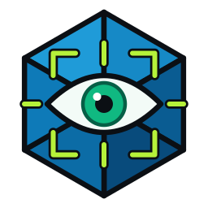

# AegiSignTrack

**Track a sign, mask it and typeset over it for Aegisub, all in one window.**

[Français](README.md) | **English**

[](LICENSE)

</div>

Pick something in the video and AegiSignTrack follows it, then hands back ASS lines: a mask over the
original sign, your own text on top of it, or only the motion, applied to lines you have already
written.

There are two pieces. `aegisigntrack` is the program (Rust, Linux and Windows).
`aegisub/aegisigntrack.lua` is the Aegisub plugin that sends it your selection and brings the result
back.

Made by AnnoyedDev.

## Features

- One point, several points or a whole area can be tracked for position, scale, rotation, shear or
  perspective.
- Fades, objects that get hidden, covered or leave the picture, and flat shapes with no texture are
  all handled.
- The mask is a flat colour, a set of gradients or a picture turned into vector shapes. A picture can
  make the script **extremely** heavy.
- Text gets its own font, colours, outline, shadow and blur. Lines already written in Aegisub can
  receive the motion instead.
- Results go to the clipboard, straight into Aegisub, to an `.ass` file, or out as tracking data for
  other tools.
- A shot can hold several tracked objects, exported in one go.

## Getting it running

1. Download the latest [release](https://github.com/AnnoyedDev/Aegisub-Sign-Track/releases). The
   archive holds the program for Linux or Windows, plus the plugin. Every commit gets a release, named
   after its date and commit, and the window title shows that name.
2. Have `ffmpeg` and `ffprobe` in the PATH or next to the program. A third option is the *ffmpeg
   folder...* button at the bottom of the settings.
3. Put `aegisigntrack.lua` in Aegisub's `automation/autoload` folder. That is
   `~/.aegisub/automation/autoload/` on Linux and `%APPDATA%\Aegisub\automation\autoload\` on Windows.
4. When `aegisigntrack` is not in the PATH, point Aegisub at it with *Automation > AegiSignTrack >
   Tracker path*.

On Linux the program writes a menu entry and its icon to `~/.local/share` when it starts
(`applications/aegisigntrack.desktop` and `icons/aegisigntrack.png`), which the desktop uses for the
window icon. Under Wayland it runs through XWayland whenever XWayland is there, since its windowing
library cannot receive dropped files on Wayland yet.

### From source

```sh
cargo build --release
```

This gives `target/release/aegisigntrack`. On Windows, install Rust through
[rustup](https://rustup.rs) first and look for `target\release\aegisigntrack.exe`.

A Windows binary can also be built on Linux once `mingw-w64-gcc` is installed:

```sh
rustup target add x86_64-pc-windows-gnu
cargo build --release --target x86_64-pc-windows-gnu
```

It ends up in `target/x86_64-pc-windows-gnu/release/aegisigntrack.exe`.

## How to use it

1. In Aegisub, select the lines of the sign and run *Automation > AegiSignTrack > Track selection*.
   The tracker opens on the stretch of video those lines cover. Outside Aegisub, start
   `aegisigntrack`, open a video or drop it on the window, and choose the range to load.
2. Work in the three tabs of the right-hand panel. Clicking on the video acts on whichever tab is
   showing.
3. Press *Send to Aegisub* to insert the lines into the script (one Ctrl+Z in Aegisub takes them out
   again), or *Copy for Aegisub* to put them on the clipboard and paste them into the grid.

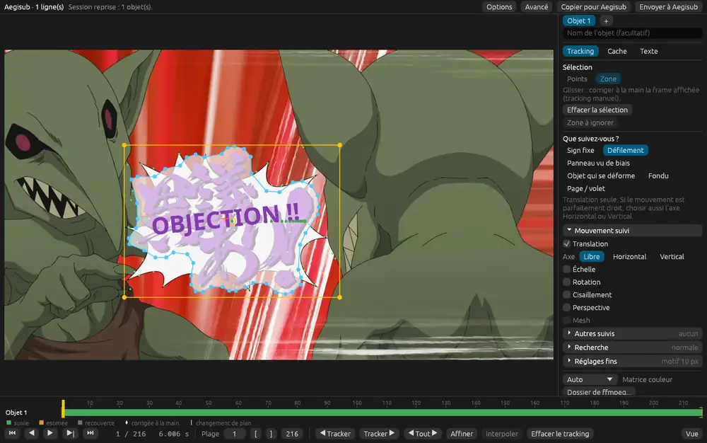

*The sign comes in at 50 px per frame. The yellow area, the mask and the text stay on it, and the green
dots trace the path of its centre. The captures on this page show the French interface.*

### The Tracking tab

*Points* follows each point you place on its own, and one is enough. *Area* follows the whole surface
of a polygon. Draw the selection by clicking on the video, tick the kinds of motion to follow and
adjust the search. *Track ▶*, *◀ Track* and *◀ All ▶* start from the displayed frame and stop at the
ends of the range, which the `[` and `]` buttons move to the displayed frame.

When the track slips, go to the frame where it went wrong, drag the selection back into place and
track again from there.

Hold Alt and turn the wheel to resize the selection around its centre, or Shift to rotate it. On a
tracked object the same two gestures correct the displayed frame, as dragging does.

Under *What are you tracking?* sit six profiles: *Still sign*, *Scrolling*, *Board seen at an angle*,
*Object that deforms*, *Fade* and *Page / shutter*. Clicking one ticks the motions and extra tracking
that suit it, and every box can still be changed afterwards. *Tracked motion*, *Other tracking*,
*Search* and *Fine settings* fold away when you click their title, and a folded section shows a short
summary of what it holds.

### The Mask tab

Tick *Export the mask*. The mask starts out as the tracked selection, and a click on the video draws a
different one that follows the tracking from that spot. Alt+wheel and Shift+wheel resize and rotate it
too.

- The colour is flat and can be picked from the video with the eyedropper. *Pick the colour again on
  every frame* reads it at the same spot of the object on each frame, which helps when the lighting
  changes.
- *Measure*, next to the blur, reads how soft the edges of the object are on the displayed frame and
  sets the mask blur to match.
- *Margin* grows or shrinks the mask by a few pixels, so you do not have to redraw it.
- Under *Gradients*, each gradient blends its colour into the mask colour in the direction and with
  the strength you choose. Several gradients stack.
- *Choose an image...* swaps the mask for a picture (PNG or another format), stretched over its
  bounding rectangle. An `.svg` keeps its shapes untouched and is not vectorised again, though its
  text and gradients are dropped.
- If the mask has exactly 4 points, *Place the image on the 4 points of the mask* pins the corners of
  the picture to them in click order: top left, top right, bottom right, bottom left. The picture is
  in perspective from the first frame.
- *Layer +* is added to the layer number of the source line.

### The Text tab

Tick *Export the text* and click where it should sit. *Customise the appearance* overrides the style
of the line with a font from those installed, a size, bold, italic, colour, outline, shadow and blur.

Selected lines that already contain text raise a question at startup: import it or not. The answer can
be changed later in the tab. Imported text keeps its wording, style and timing. Each line is tracked
over its own duration and replaced by its tracked versions, the original is commented out, and all of
them go where you clicked on the video. With *Text typed here*, the lines only mark out the video, and
what you type in the tab is added beside them without touching them.

- *Visible only inside the mask* clips the text to the shape of the mask (`\clip`), and *Hidden by the
  mask* does the opposite (`\iclip`). To slip text behind a character, draw the mask over the
  character. The mask follows the tracking and does not need to be exported.
- *Blur the inside of the letters too* writes every line twice, the outline underneath and the bare
  letters above, because an ASS blur on its own only softens the outside of the outline.
- *Measure* gives the text the same blur as the edges of the tracked object.
- *Layer +* set to 1 here and 0 for the mask keeps the text in front, however the lines get sorted or
  moved in Aegisub. Left at 0 on both, layers stay as they were.

*Starting pose* is for a surface that already sits at an angle on the frame where you place the text.
*X* tips the text forwards or backwards (`\frx`), *Y* swings it left or right (`\fry`), *Z* turns it
flat (`\frz`) and *Size* scales it. Over the video, Shift+wheel turns it and Alt+wheel resizes it.
Tracking takes that pose as its starting point and carries it along with the object.

A line you already put in perspective in Aegisub keeps it. Its `\frx`, `\fry`, `\frz`, `\fax`, `\org`,
`\fscx` and `\fscy` become the starting pose, the values from the tab are added on top, and this holds
when you export the tracking alone too.

*Attachment plane* lays four corners on the surface that carries the text, even far from the tracked
area. The plane follows the tracking and tracks nothing itself. With *Place*, drag its corners onto the
surface, and the text stays where it is. A grid extends the plane to its horizon so you can judge the
perspective, and the thick side of the frame is the top. *Lay the text on the plane* gives the text
that perspective, the way the perspective tool in Aegisub does with its four-corner frame. The
*Straightened view* then shows the surface flat and from the front. With a well placed plane the
surface looks straight there and stays still during playback.

*Correct here* is for a text that slips on a frame although the area follows well, which happens when
the artwork is redrawn in the middle of a shot. On that frame, put the corners back on the same
surface. The text follows, and the correction holds for the frames after it, going away from the start
frame, until the next correction. The corrected frames are listed under the buttons, with *Delete this
one*. The attachment plane needs *Area* mode.

libass renders the text preview through ffmpeg, during playback as well, so you see what Aegisub will
show. The font may differ if the style is unknown.

### What follows what

The mask and the text each have a *What it follows from the tracking* list: movement, growing or
shrinking, rotation, perspective, opacity. The text could follow the movement alone while the mask
follows everything.

Ticking *Perspective and distortion* for the text makes the export write `\fscx` and `\fscy`
separately, followed by `\frx`, `\fry`, `\fax` and, where needed, `\org`. The text then squashes,
stretches and tilts with the object. This only works if the tracking recorded that distortion, which
takes *Shear* or *Perspective* in the Tracking tab. Text on several lines (`\N`) comes out slightly
less accurate.

### What gets exported

Mask and text can be exported together. Both start unticked, and exporting with neither asks for
confirmation and then gives the tracking alone: every selected line keeps its text and position
(`\pos`, or the centre of the area without one) and receives position, size and rotation frame by
frame. Outside Aegisub you get empty lines that carry those tags and nothing else.

Copying or sending first opens a summary. For each object it lists the mask lines, the text lines, the
tracked frames and the estimated frames worth checking, followed by the total, the size added to the
script and what merging and grouping save. Two switches exist only there:

- *Comment out the original lines* applies to imported text sent to Aegisub. Unticked, the original
  lines are deleted and their tracked versions take their place.
- *Put each object on its own layer* adds 2 to the layer number for every object.

Untick *Options > Summary before export* to skip the summary.

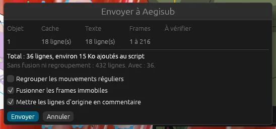

More outputs and two line-saving switches live in the *Options* menu:

- *Save as .ass...* writes a complete file with header and styles.
- *Tracking data* copies the track of the displayed object as "After Effects Keyframe Data", the
  format Aegisub-Motion reads.
- *Power Pin data* copies the 4 corners of the mask frame by frame, for perspective scripts.
- *Merge still frames* uses a single line for as long as the mask or the text stays put (within
  0.15 px). Untick it to keep one line per frame.
- *Group steady motion* replaces a run of frames where the text moves steadily with one line using
  `\move` and `\t`.

Script size grows fast. A gradient costs one line per band and per frame, with 16 bands by default. A
picture costs one line per colour and per frame, each holding the full outline of that colour, which
is why pictures are first cut down to 200 px a side and a handful of colours. That limit may move, but
I doubt you want a 1 GB .ass and an Aegisub that crawls.

### Keys and mouse

| Input | Action |
|---|---|
| ← and →, or Alt+Q and Alt+D | Previous frame, next frame |
| Space or Ctrl+Space | Play, pause |
| Ctrl+Z, Ctrl+Shift+Z | Undo, redo |
| H | Hide or show the overlays |
| F or Ctrl+0 | Fit the whole video back in the window |
| Wheel | Zoom |
| Alt+wheel | Resize the selection, the mask or the text, whichever tab is open |
| Shift+wheel | Rotate it |
| Right or middle button held | Move the view |

Keys do nothing while you are typing in a field.

## Difficult shots

| What happens | What helps |
|---|---|
| It crosses the picture very fast | Draw the area on a frame where the object is whole, ideally one where it stands still, set *Search* to *Large* and press *◀ All ▶*. The slider goes up to 600 px. Past 96 px its label turns red, since tracking gets slower and is more likely to latch onto a look-alike. On the frame where it has barely entered the picture, too little of it is visible to track |
| It snaps or swings to a new place between two frames | Use *Area* with *Realign on the start frame* ticked. The moment the track lets go, the tracker looks for the object up to half the area's diagonal away, turned by 40° at most and close to its previous size. A board that swings also changes perspective, so tick *Perspective*. Draw the area on the artwork or the lettering, because the rim of a board gets in the way here: its thickness and its shadow change with the angle. When nothing looks enough like the start frame, the frames are marked estimated |
| The text shakes although the area is steady | It sits too far from the area, and a tiny error on the area grows with distance. On a board 900 px tall, a text placed at the top moved by 0.5 px with the area right below it, by 2.4 px with the area 480 px lower and by 7.5 px with the area at the very bottom. Draw the area on what lies right next to the text and leave the rim of the object out of it. When the text is far from the area, an orange warning shows in the Text tab and in the export summary, including for Aegisub lines exported as tracking only |
| The text slips after a swing although the area follows well | The artwork was redrawn: its outline and its lettering did not move together, and a text placed far from the area follows what is inside the area. In the Text tab, use *Attachment plane*: place the plane on the surface under the text, go to the first frame after the swing and put its corners back with *Correct here*. The other way is to split the line in Aegisub at the frame of the swing, place the text again on the first frame of each half, then track each half on its own, drawing the area on that first frame |
| The object pops in suddenly | Go to a frame where it shows clearly, draw the area and use *◀ Track* to run backwards in time |
| Flat colour, no detail | Use *Area* and draw it on the edges of the object or just around them. The tracker lines up the outlines with those of the start frame, so texture is not needed. The *Automatic* channel (the default) picks the colour mix where the area stands out best, which keeps an object trackable when it is as bright as the background. *View*, beside *Channel*, shows the video in greyscale as the tracker sees it |
| It grows a lot or leaves the picture | In *Area* mode the tracker picks new points in the part still visible once too many are lost, and carries on with the same motion. An area that is almost entirely off screen keeps going on its momentum |
| It squashes, stretches or is seen at an angle | Tick *Shear* or *Perspective* before tracking. Otherwise the track lets go as soon as the object deforms, and the closing message says so |
| Its surface bends | *Mesh* tracks a grid of points one by one, and the selection bends with the surface |
| It goes behind something | With *Area* mode and *Realign on the start frame* ticked, the tracker carries the path on (movement and rotation) and picks the object up when it shows again. While the object is lost it searches the whole picture, near the expected orientation and size. An identical object passing over the target can fool that recovery |
| Something slides over it | Set *Covering*, described below |
| It fades in or out | Tick *Opacity* under *Other tracking* before tracking, from a frame where the area shows clearly. The selection holds its place once it turns invisible, and *Opacity (fades)* gets ticked for the mask and the text, which receive `\alpha` frame by frame. Each of them can also set that box in its own list |
| The track drifts little by little | *Realign on the start frame* (ticked by default, in the Search section) lines every frame up with the one where tracking began, so small errors cannot add up. Untick it if the object truly changes its look along the way. *Refine* does the same realignment afterwards on the tracked frames of the range, for instance after you moved the selection by hand |
| Part of the area is animated or is not part of the object | Draw an *Area to ignore* around it, in *Area* mode and before tracking. That part no longer counts |
| The motion is perfectly straight | Under *Translation*, set *Axis* to *Horizontal* or *Vertical*. The centre of the object is frozen on the other axis with no jitter at all, including while the object is hidden and its path carried on. Untick *Scale* and *Rotation* as well. Keep this for scrolling credits and pans, because the track will be wrong if the object also moves the other way |
| The shot changes | When started from Aegisub, the tracker receives its keyframes and keeps only those where the picture jumps. They show as white marks on the timeline, and tracking stops there. A window then offers *Continue*, which carries on past the mark and removes it, or *Edit the tracking*, which takes you to the frame where it stopped. Untick *Options > Stop at scene changes* to run through every mark unasked |
| The object stays lost to the end | If a track ends on estimated frames, an *Object lost* window names the frame where it let go. *Edit the tracking* goes there so you can fix it by hand and track again, *Close* keeps the estimate, and *Don't show again* silences the window until you quit the program |
| The sign leaves the picture or fades before the end | Set the range to the frames you need, then *Advanced > Extrapolate*. Untracked frames before and after the track are filled by carrying its motion on, and shown in orange |

### Covering

A page being turned, a shutter, someone walking in front: for these, set *Covering* under *Other
tracking*, in *Area* mode. The colours of the area are compared with those of the start frame. The
mask and the text are cut along the edge that covers them, with one `\clip` per frame, and the object
stops being exported once it is fully covered. On the video, the outline of the area shows the part
still visible, then the word "covered" when nothing is left.

| Mode | Behaviour |
|---|---|
| *Ignore* | No detection (the default) |
| *Passing* | Whatever gets covered can come back |
| *Lasting* | Whatever has been covered stays covered, even when a look-alike turns up at the same place afterwards, such as the next page of a book |

*Tolerance* sets how far a colour may differ. The covering edge is assumed to be straight, and a fade
or changing light is mistaken for a cover. Text set to *Hidden by the mask* is not cut, although it
does disappear once the object is covered.

## Checking and fixing a track

The timeline has one track per object, and clicking a track shows that object at the frame you
clicked. Frames are coloured:

| Colour | Frame | Exported |
|---|---|---|
| Green | Tracked | Yes |
| Orange | Estimated: object lost or hidden, position carried on | Yes |
| Grey | Object covered | No |

The closing message counts the orange frames, and they are worth checking. *◀ estimated* and
*estimated ▶* jump from one to the next. Once you have put one back by hand, *Interpolate* rebuilds a
steady passage between the reliable frames and *Refine* realigns it.

A white diamond marks a frame corrected by hand. Right-click it to jump there or to delete the
correction, which turns the frame back into an estimate that *Interpolate* can rebuild.

Several entries of the *View* menu help you judge a track:

- *Lock the view on the object* holds the object still on screen, so any slip shows at once.
- The *Confidence curve* is on by default and runs under the track of the displayed object. Green
  means a reliable track. It shifts to yellow, orange and then red as confidence drops.
- *Grid on the object* lays a grid on the tracked plane in *Area* mode. A grid that slides over the
  object during playback means the track is slipping.
- *Path of the centre*, also on by default, draws one dot per frame. Dots take the colours of the
  confidence curve, and estimated frames are orange. In the Tracking tab,
  clicking a dot goes to its frame and dragging it corrects that frame. Neighbouring frames follow
  smoothly, as many on each side as *Neighbours pulled along* says (6 by default).
- *Straightened view* opens a window showing the object from the front and standing still on every
  frame. Movement in that window during playback means the track needs fixing. In the Text tab, a click
  in that window places the text straight. Once an attachment plane is placed, it straightens the
  surface of that plane.
- The *Magnifier* enlarges the video around the pointer for placing a point to the pixel.
- *Hide overlays* (the H key) leaves only the video, to compare with the untouched picture.
- *Loop playback over the range* sends playback back to the start of the range.

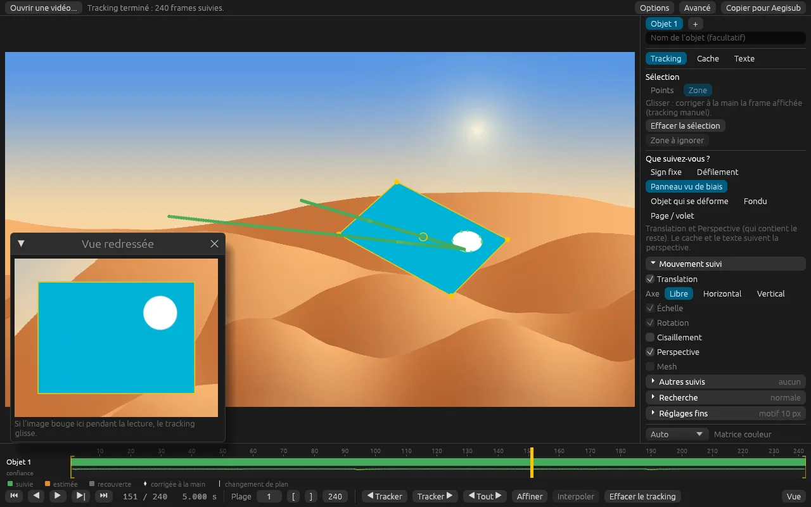

*The video shows the blue board at an angle. The straightened view, bottom left, shows it from the
front.*

The *Advanced* menu is for adjusting a track or bringing one in:

- *Tracking curves* plots position, size and rotation over time. One component can be smoothed alone,
  for example a shaky rotation while the position is left as it is, and the displayed frame can be
  edited by typing exact values. With the window closed and the sliders at 0, nothing changes.
- *Import tracking data...* reads an "After Effects Keyframe Data" file from Mocha, After Effects or
  Blender, holding position, scale and rotation or the 4 Power Pin corners. It is applied to the
  displayed object from the start of the range, and mask, gradients and text then work as they do
  after a normal track.

## Other settings

### Several objects

The row *Object 1, Object 2, +* sits at the top of the settings, above a field for naming the
displayed object. The name shows on its track and in the export summary. Every object has its own
tracking, mask and text. The others stay visible as grey outlines, and all of them are exported together.

### Settings and sessions

Settings are saved on exit and on export, and come back when you reopen the same Aegisub script, or
the same video outside Aegisub. The work is saved too (objects, areas, masks, tracking): reopen the
same video on the same range and AegiSignTrack offers to resume it or start from scratch. The picture
of a mask is not kept, and a session older than 30 days is deleted.

### Language

*Options > Langue / Language* switches between French and English. The first launch follows the
system language. The plugin picks the choice up the next time Aegisub starts.

### Updates

At startup AegiSignTrack looks on GitHub for a newer release. When there is one, it shows the
installed version and the new one, with a button to the download page. Nothing is installed for you.
The check needs `curl`, which ships with Windows 10 and 11, and can be switched off in the *Options*
menu.

### Colours

When the picture or the eyedropper gives the wrong colours, *Colour matrix* at the top of the settings
forces BT.709 or BT.601.

### Different results on two machines

Start by comparing the version in the window title. If it matches, redo the track with the same
gestures on both machines, save *Options > Diagnostic...* on each and compare the two files: ffmpeg
version, hashes of the decoded pictures, settings, selection, then the result frame by frame.

## Examples

These clips come from two sets of test videos. The tracked area is drawn in yellow and switches to
orange while the position is estimated, which happens when the object is hidden or out of frame.

<table>
<tr>
<td align="center" valign="top" width="25%">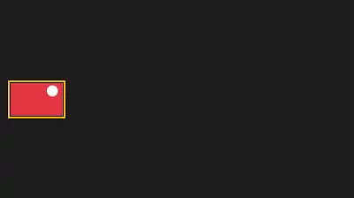<br><sub>Translation</sub></td>
<td align="center" valign="top" width="25%">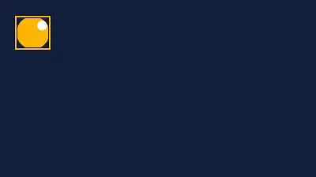<br><sub>Curved path, accelerations</sub></td>
<td align="center" valign="top" width="25%">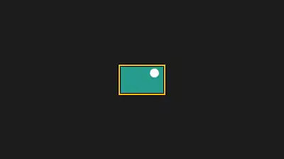<br><sub>Scale</sub></td>
<td align="center" valign="top" width="25%">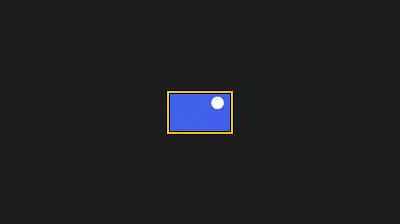<br><sub>Rotation</sub></td>
</tr>
<tr>
<td align="center" valign="top" width="25%">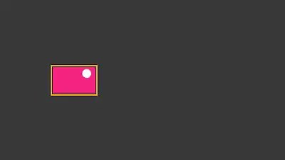<br><sub>Fade</sub></td>
<td align="center" valign="top" width="25%">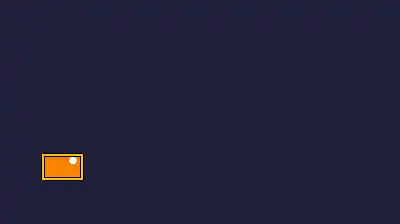<br><sub>Translation, scale, rotation and fade</sub></td>
<td align="center" valign="top" width="25%">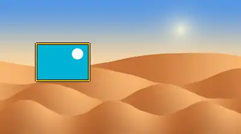<br><sub>Perspective over a video background</sub></td>
<td align="center" valign="top" width="25%">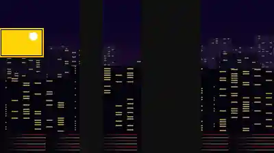<br><sub>Occlusion and leaving the frame</sub></td>
</tr>
<tr>
<td align="center" valign="top" width="25%">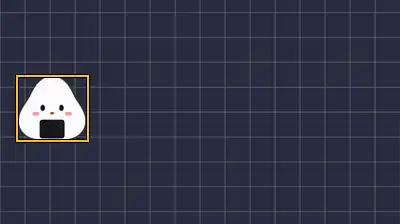<br><sub>Translation</sub></td>
<td align="center" valign="top" width="25%">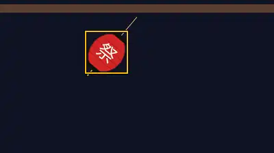<br><sub>Pendulum</sub></td>
<td align="center" valign="top" width="25%">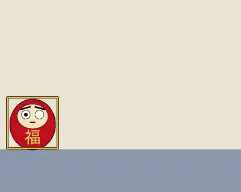<br><sub>Squashing object, with Shear</sub></td>
<td align="center" valign="top" width="25%">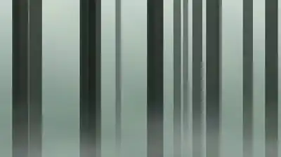<br><sub>Object coming in and out, tracked backwards</sub></td>
</tr>
<tr>
<td align="center" valign="top" width="25%">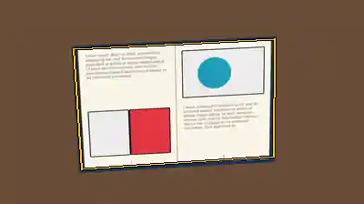<br><sub>Book in perspective</sub></td>
<td align="center" valign="top" width="25%">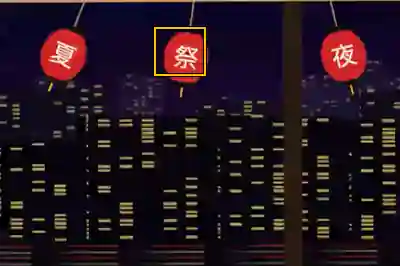<br><sub>Lantern, handheld camera</sub></td>
</tr>
</table>

Seven cases from the same sets are left out. In five of them the track still lets go at times:
decoys identical to the target, a video that stacks every difficulty, a hinged fan folding shut, two
objects shot with a handheld camera, and a magazine folded in someone's hand. The other two, a
swelling speech bubble and an oversized object that shrinks, are tracked but need touching up by hand.

## Tests

```sh
cargo test --release
```

They cover tracking, ASS export and video extraction, and they need ffmpeg.

## Licence

CC BY-NC-SA 4.0, copyright 2026 AnnoyedDev. Commercial use is not allowed, and a modified version that
gets distributed has to carry the same licence. The full text is in `LICENSE`.
