<div align="center">

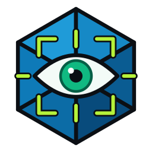

# AegiSignTrack

**Le tracking, le cache et le typeset d'un sign dans une seule fenêtre, pour Aegisub.**

**Français** | [English](README.en.md)

[](LICENSE)

</div>

AegiSignTrack suit un élément de la vidéo et écrit les lignes ASS qui vont avec : un cache qui recouvre
le sign d'origine, un texte posé dessus, ou le mouvement seul, appliqué à des lignes déjà écrites.

Il se compose du logiciel `aegisigntrack` (Rust, Linux et Windows) et du plugin Aegisub
`aegisub/aegisigntrack.lua`, qui lui envoie la sélection et récupère le résultat.

Développé par AnnoyedDev.

## Ce qu'il fait

- Suivi d'un point, de plusieurs points ou d'une zone, en translation, échelle, rotation, cisaillement
  ou perspective.
- Prise en compte des fondus, des objets cachés, recouverts ou sortis de l'image, et des aplats sans
  texture.
- Cache en aplat, en dégradés ou à partir d'une image vectorisée. Une image peut rendre le script
  **extrêmement** lourd.
- Texte avec sa police, ses couleurs, son contour, son ombre et son flou, ou lignes déjà écrites dans
  Aegisub qui reçoivent le mouvement.
- Export dans le presse-papiers, directement dans Aegisub, en fichier `.ass` ou en données de tracking
  pour d'autres outils.
- Plusieurs objets suivis dans le même plan et exportés ensemble.

## Installation

1. Télécharger la dernière [release](https://github.com/AnnoyedDev/Aegisub-Sign-Track/releases).
   L'archive contient l'exécutable (Linux ou Windows) et le plugin. Une release sort à chaque commit ;
   son numéro, date et commit, s'affiche dans le titre de la fenêtre.
2. Installer `ffmpeg` et `ffprobe` : dans le PATH, à côté de l'exécutable, ou dans un dossier indiqué
   avec *Dossier de ffmpeg...*, en bas des réglages.
3. Copier `aegisigntrack.lua` dans le dossier `automation/autoload` d'Aegisub :
   `~/.aegisub/automation/autoload/` sous Linux, `%APPDATA%\Aegisub\automation\autoload\` sous Windows.
4. Si `aegisigntrack` n'est pas dans le PATH, donner son emplacement dans Aegisub avec
   *Automatisme > AegiSignTrack > Chemin du tracker*.

Sous Linux, AegiSignTrack crée à son lancement une entrée de menu et son icône dans `~/.local/share`
(`applications/aegisigntrack.desktop` et `icons/aegisigntrack.png`), dont le bureau se sert pour l'icône
de la fenêtre. Sur un bureau Wayland il passe par XWayland quand celui-ci est installé, parce que sa
bibliothèque de fenêtrage n'accepte pas encore le dépôt de fichiers sous Wayland.

### Compiler soi-même

```sh
cargo build --release
```

L'exécutable est `target/release/aegisigntrack`. Sous Windows, installer d'abord Rust avec
[rustup](https://rustup.rs) ; l'exécutable est alors `target\release\aegisigntrack.exe`.

Pour produire l'exécutable Windows depuis Linux, il faut `mingw-w64-gcc` :

```sh
rustup target add x86_64-pc-windows-gnu
cargo build --release --target x86_64-pc-windows-gnu
```

Le résultat est `target/x86_64-pc-windows-gnu/release/aegisigntrack.exe`.

## Utilisation

Depuis Aegisub, sélectionner les lignes du sign puis lancer *Automatisme > AegiSignTrack > Tracker la
sélection*. Le tracker s'ouvre sur la portion de vidéo que ces lignes couvrent. Sans Aegisub, lancer
`aegisigntrack`, ouvrir une vidéo (ou la glisser dans la fenêtre) et choisir la plage à charger.

Le panneau de droite a trois onglets. Un clic sur la vidéo agit sur l'onglet affiché.

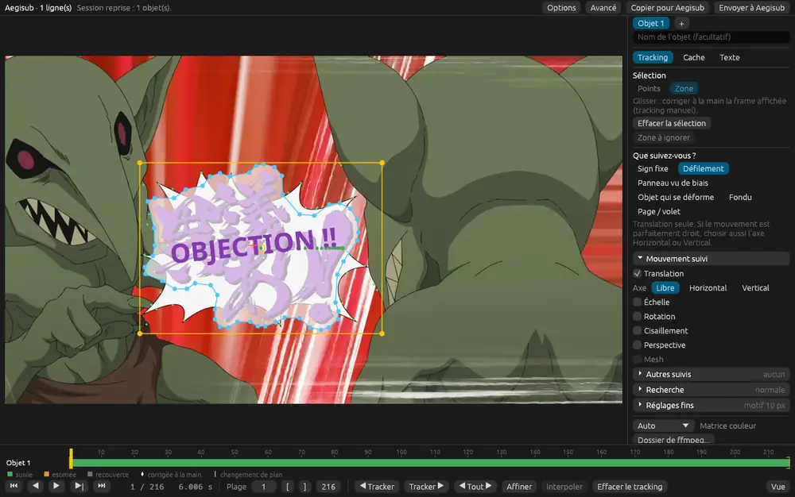

*Le sign entre dans l'image à 50 px par image. La zone jaune, le cache et le texte le suivent, et les
points verts dessinent la trajectoire de son centre.*

### Tracking

Choisir *Points* (un ou plusieurs, chacun suivi séparément) ou *Zone* (un polygone suivi sur toute sa
surface), cliquer sur la vidéo pour dessiner la sélection, cocher les mouvements à suivre et régler la
recherche. *Tracker ▶*, *◀ Tracker* et *◀ Tout ▶* partent de la frame affichée et s'arrêtent aux bornes
de la plage. Les boutons `[` et `]` placent ces bornes sur la frame affichée.

Si le suivi dérape, aller sur la frame fautive, glisser la sélection au bon endroit et relancer de là.

Alt+molette agrandit ou réduit la sélection et Maj+molette la tourne, autour de son centre. Une fois le
tracking fait, les deux gestes corrigent la frame affichée, comme le glisser.

*Que suivez-vous ?* propose six profils : *Sign fixe*, *Défilement*, *Panneau vu de biais*, *Objet qui se
déforme*, *Fondu* et *Page / volet*. Un clic coche les mouvements et les suivis qui conviennent, et
chaque case reste modifiable ensuite. Les sections *Mouvement suivi*, *Autres suivis*, *Recherche* et
*Réglages fins* se replient d'un clic sur leur titre ; repliées, elles affichent un résumé de leur état.

### Cache

Cocher *Exporter le cache*. Il reprend la sélection du tracking. Un clic sur la vidéo en dessine un
autre, qui suit le tracking depuis cet endroit. Alt+molette et Maj+molette l'agrandissent et le
tournent.

| Réglage | Effet |
|---|---|
| Couleur | Aplat, avec une pipette sur la vidéo. *Reprendre la couleur à chaque frame* la relève au même endroit de l'objet sur chaque frame, pour un éclairage qui change |
| Flou | *Mesurer* relève le flou des bords de l'objet sur la frame affichée et règle celui du cache en conséquence |
| *Marge* | Élargit ou rétrécit le cache de quelques pixels sans le redessiner |
| *Dégradés* | Chaque dégradé fond sa couleur sur celle du cache, dans le sens et avec la force choisis. Plusieurs dégradés se superposent |
| Image | *Choisir une image...* met une image (PNG ou autre) à la place du cache, étirée sur le rectangle qui l'entoure. Un `.svg` garde ses formes telles quelles, sans vectorisation ; son texte et ses dégradés ne sont pas repris |
| *Poser l'image sur les 4 points du cache* | Avec un cache d'exactement 4 points, place les coins de l'image dessus dans l'ordre des clics (haut gauche, haut droit, bas droit, bas gauche). L'image est en perspective dès la première frame |
| *Calque +* | S'ajoute au numéro de calque de la ligne d'origine |

### Texte

Cocher *Exporter le texte* et cliquer sur la vidéo pour le placer. *Personnaliser l'apparence* remplace
le style de la ligne : police (parmi celles installées), taille, gras, italique, couleur, contour,
ombre, flou.

Si les lignes sélectionnées dans Aegisub contiennent du texte, AegiSignTrack demande au lancement s'il
faut l'importer. Le choix se change ensuite dans l'onglet.

- *Texte importé* : chaque ligne garde son texte et son style, est suivie sur sa propre durée, puis
  remplacée par ses versions trackées. L'originale passe en commentaire. Toutes sont placées à
  l'endroit cliqué sur la vidéo.
- *Texte saisi ici* : les lignes ne servent qu'à délimiter la vidéo. Le texte tapé dans l'onglet est
  ajouté à côté d'elles, sans les modifier.

| Réglage | Effet |
|---|---|
| *Visible seulement dans le cache* | Découpe le texte avec la forme du cache (`\clip`) |
| *Caché par le cache* | L'inverse (`\iclip`). Pour faire passer un texte derrière un personnage, dessiner le cache sur lui. Le cache suit le tracking et n'a pas besoin d'être exporté |
| *Flouter aussi l'intérieur des lettres* | Exporte chaque ligne deux fois, le contour dessous et les lettres sans contour dessus. En ASS, le flou seul ne touche que l'extérieur du contour |
| *Mesurer* | Donne au texte le flou des bords de l'objet suivi |
| *Calque +* | Avec 1 ici et 0 pour le cache, le texte reste devant le cache même si les lignes sont triées ou déplacées dans Aegisub. À 0 partout, les calques ne changent pas |

*Pose de départ* sert quand la surface est déjà vue de biais sur la frame où le texte est placé. *X* le
bascule vers l'avant ou l'arrière (`\frx`), *Y* le fait pivoter vers la gauche ou la droite (`\fry`),
*Z* le tourne à plat (`\frz`) et *Taille* l'agrandit ou le réduit. Sur la vidéo, Maj+molette le tourne
et Alt+molette change sa taille. Le tracking part de cette pose et la fait évoluer avec l'objet.

Une ligne déjà mise en perspective dans Aegisub garde ce réglage : ses `\frx`, `\fry`, `\frz`, `\fax`,
`\org`, `\fscx` et `\fscy` servent de pose de départ, et les valeurs de l'onglet s'y ajoutent. C'est
aussi le cas quand on n'exporte que le tracking.

*Plan d'attache* pose quatre coins sur la surface qui porte le texte, même loin de la zone suivie. Le
plan suit le tracking et ne tracke rien lui-même. Avec *Poser*, glissez ses coins sur la surface : le
texte ne bouge pas. Un quadrillage prolonge le plan jusqu'à son horizon, ce qui montre si la perspective
est la bonne, et le côté épais du cadre marque le haut. *Coucher le texte sur le plan* donne au texte
cette perspective, comme l'outil de perspective d'Aegisub le fait avec son cadre à quatre coins. La
*Vue redressée* montre alors la surface à plat et de face : un plan bien posé y donne une surface
droite, immobile pendant la lecture.

*Corriger ici* sert quand le texte glisse sur une frame alors que la zone suit bien, par exemple quand
le dessin est refait en cours de plan. Sur cette frame, replacez les coins sur la même surface : le
texte suit, et la correction vaut pour les frames suivantes en s'éloignant de la frame de départ,
jusqu'à la correction suivante. Les frames corrigées sont listées sous les boutons, avec *Effacer
celle-ci*. Le plan d'attache demande le mode *Zone*.

*Problème suivant ▶* cherche pour vous où corriger. Il avance depuis la frame affichée, en s'éloignant
de la frame de départ, et s'arrête à la première frame où la surface du plan ne ressemble plus à sa
dernière référence, qui est la frame de départ ou la dernière correction. Il y propose jusqu'à quatre
cadres de couleur, *Suivi tel quel*, *Plan recalé*, *Autour du texte* et *Recherche élargie*, chacun
avec un pourcentage de ressemblance. Un clic sur un cadre le prend comme correction, et ses coins
restent ajustables. *Suivi tel quel* valide la frame sans rien changer, ce qui en fait la nouvelle
référence. *Chercher ici* fait les mêmes propositions sur la frame affichée. Ces cadres sont des points
de départ : quand le dessin a été refait, aucun n'est forcément exact, et sur un objet qui se balance
la recherche peut s'arrêter à chaque nouvelle pose.

L'aperçu du texte est rendu par libass (via ffmpeg), y compris pendant la lecture. Il montre ce
qu'Aegisub affichera, à la police près si le style n'est pas connu.

### Ce que suivent le cache et le texte

Chacun a sa liste *Ce qu'il suit du tracking* : déplacement, agrandissement, rotation, perspective,
opacité. Le texte peut par exemple suivre le déplacement seul pendant que le cache suit tout.

Avec *Perspective et déformation* coché pour le texte, l'export écrit `\fscx` et `\fscy` séparément,
puis `\frx`, `\fry`, `\fax` et au besoin `\org`. Le texte s'écrase, s'étire et se couche comme l'objet,
à condition que le tracking ait suivi cette déformation, donc avec *Cisaillement* ou *Perspective*
coché dans l'onglet Tracking. Un texte sur plusieurs lignes (`\N`) est un peu moins juste.

### Export

*Envoyer à Aegisub* insère les lignes dans le script, et un Ctrl+Z dans Aegisub annule l'insertion.
*Copier pour Aegisub* les met dans le presse-papiers, à coller dans la grille. Le cache et le texte
peuvent être exportés ensemble.

Les deux sont décochés au départ. Si aucun n'est coché, l'export demande confirmation puis ne produit
que le tracking : chaque ligne sélectionnée garde son texte et sa position (`\pos`, sinon le centre de
la zone) et reçoit position, taille et rotation frame par frame. Hors Aegisub, ce sont des lignes vides
qui ne portent que ces balises.

Avant de copier ou d'envoyer, un récapitulatif donne pour chaque objet le nombre de lignes du cache et
du texte, les frames suivies et les frames estimées à vérifier, puis le total, le poids ajouté au script
et ce que la fusion et le regroupement font gagner. Deux réglages n'existent que là :

- *Mettre les lignes d'origine en commentaire* (texte importé, envoi à Aegisub). Décoché, les lignes
  d'origine sont supprimées et remplacées par leurs versions trackées.
- *Ranger chaque objet dans son propre calque* ajoute 2 au numéro de calque à chaque objet.

*Options > Récapitulatif avant l'export* le désactive.

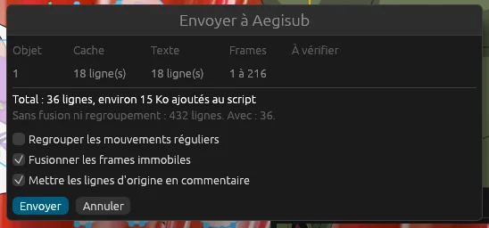

Le menu *Options* propose d'autres sorties et deux réglages qui allègent le script :

| Entrée | Effet |
|---|---|
| *Enregistrer en .ass...* | Écrit un fichier complet, en-tête et styles compris |
| *Données de tracking* | Copie le suivi de l'objet affiché au format « After Effects Keyframe Data », celui que lit Aegisub-Motion |
| *Données Power Pin* | Copie les 4 coins du cache frame par frame, pour les scripts de perspective |
| *Fusionner les frames immobiles* | Tant que le cache ou le texte ne bouge pas (à 0,15 px près), une seule ligne couvre toute la durée. Décocher pour garder une ligne par frame |
| *Regrouper les mouvements réguliers* | Pour le texte, remplace une suite de frames au mouvement régulier par une seule ligne avec `\move` et `\t` |

Un dégradé ajoute une ligne par bande et par frame (16 bandes par défaut). Une image ajoute une ligne
par couleur et par frame, et chacune contient tout le contour de cette couleur. L'image est donc
réduite à 200 px de côté et à quelques couleurs avant d'être convertie en formes. Ça pourra changer,
mais je doute que vous ayez envie d'un .ass de 1 Go et d'un Aegisub qui rame.

### Raccourcis

| Touche | Action |
|---|---|
| ← et →, ou Alt+Q et Alt+D | Frame précédente, frame suivante |
| Espace ou Ctrl+Espace | Lecture, pause |
| Ctrl+Z, Ctrl+Maj+Z | Annuler, rétablir |
| H | Masquer ou revoir les tracés |
| F ou Ctrl+0 | Remettre la vidéo entière dans la fenêtre |
| Molette | Zoom |
| Alt+molette | Agrandir ou réduire la sélection, le cache ou le texte, selon l'onglet ouvert |
| Maj+molette | Les tourner |
| Clic droit ou clic molette maintenu | Déplacer la vue |

Les touches sont ignorées pendant la saisie dans un champ.

## Cas difficiles

| Situation | Quoi faire |
|---|---|
| Il traverse l'image très vite | Dessiner la zone sur une image où il est entier, de préférence immobile, régler *Recherche* sur *Grand*, puis *◀ Tout ▶*. Le curseur monte jusqu'à 600 px. Au-delà de 96 px son libellé rougit, parce que le suivi ralentit et risque davantage d'accrocher un objet ressemblant. Sur l'image où il entre à peine dans le champ, il reste trop peu de l'objet pour le suivre |
| Il saute ou bascule d'un coup d'une frame à l'autre | Mode *Zone* avec *Recaler sur la frame de départ* coché : dès que le suivi décroche, le tracker recherche l'objet jusqu'à une demi-diagonale de zone de sa dernière position, tourné de 40° au plus et à une taille proche. Un panneau qui pivote change aussi de perspective, donc cocher *Perspective*. Tracer la zone sur le dessin ou les lettres : le bord du panneau gêne ici, parce que son épaisseur et son ombre changent avec l'angle. Si rien ne ressemble assez à la frame de départ, les frames sont marquées estimées |
| Le texte tremble alors que la zone est stable | Il est trop loin de la zone : une erreur minuscule sur la zone grossit avec la distance. Sur un panneau de 900 px de haut, un texte posé en haut bougeait de 0,5 px avec la zone juste dessous, de 2,4 px avec la zone 480 px plus bas et de 7,5 px avec la zone tout en bas. Tracer la zone sur ce qui se trouve juste à côté du texte, sans y mettre le bord de l'objet. Quand le texte est loin de la zone, un avertissement orange s'affiche dans l'onglet Texte et dans le récapitulatif d'export, y compris pour les lignes d'Aegisub exportées en tracking seul |
| Le texte se décale après une bascule alors que la zone suit bien | Le dessin a été refait : son contour et ses lettres n'ont pas bougé ensemble, et un texte posé loin de la zone suit ce qu'il y a dans la zone. Onglet Texte, *Plan d'attache* : poser le plan sur la surface du texte, aller sur la première frame d'après la bascule et y replacer ses coins avec *Corriger ici*. Autre méthode : couper la ligne dans Aegisub à la frame de la bascule, replacer le texte sur la première frame de chaque moitié, puis tracker chaque moitié à part en dessinant la zone sur cette première frame |
| L'objet apparaît d'un coup | Se placer sur une frame où il est bien visible, dessiner la zone, puis *◀ Tracker* pour remonter le temps |
| Aplat de couleur, objet sans détails | Mode *Zone*, tracée sur les bords de l'objet ou juste autour : le tracker aligne les contours sur ceux de la frame de départ, même sans texture. Le canal *Automatique* (par défaut) choisit le mélange de couleurs où la zone ressort le mieux, ce qui permet de suivre un objet de même luminosité que le décor. *Voir*, à côté de *Canal*, montre la vidéo comme le tracker la voit, en niveaux de gris |
| Il grossit beaucoup ou sort de l'image | Mode *Zone* : quand trop de points sont perdus, le tracker en reprend dans la partie encore visible et continue le même mouvement. Une zone presque entièrement sortie continue sur sa lancée |
| Il s'écrase, s'étire ou se voit de biais | Cocher *Cisaillement* ou *Perspective* avant de tracker. Sans cela le suivi décroche dès que l'objet se déforme, et le message de fin le signale |
| Sa surface se plie | *Mesh* suit une grille de points un par un, et la sélection se déforme avec la surface |
| Il passe derrière autre chose | Mode *Zone* avec *Recaler sur la frame de départ* coché : le tracker prolonge la trajectoire (déplacement et rotation) et reprend l'objet dès qu'il reparaît. Tant qu'il est perdu, l'objet est recherché dans toute l'image, à une orientation et une taille proches de celles attendues. Un objet identique qui passe sur la cible peut tromper la reprise |
| Quelque chose le recouvre peu à peu | Régler *Recouvrement* (voir plus bas) |
| Il apparaît ou disparaît en fondu | Cocher *Opacité* sous *Autres suivis* avant de tracker, en partant d'une frame où la zone est bien visible. La sélection reste en place quand elle devient invisible, et *Opacité (fondus)* se coche pour le cache et le texte, qui reçoivent `\alpha` frame par frame. Cette case se règle aussi séparément dans la liste de chacun |
| Le suivi se décale peu à peu | *Recaler sur la frame de départ* (coché par défaut, section Recherche) réaligne chaque frame sur celle où le tracking a commencé, ce qui empêche les petites erreurs de s'additionner. À décocher si l'objet change vraiment d'aspect en cours de route. *Affiner* fait le même recalage après coup sur les frames suivies de la plage, par exemple après avoir replacé la sélection à la main |
| Une partie de la zone s'anime ou n'appartient pas à l'objet | *Zone à ignorer*, en mode *Zone* et avant de tracker : la partie entourée ne compte plus dans le suivi |
| Le mouvement est parfaitement droit | Sous *Translation*, régler *Axe* sur *Horizontal* ou *Vertical* : le centre de l'objet reste figé sur l'autre axe, sans aucun tremblement, même quand l'objet est caché et sa trajectoire prolongée. Décocher aussi *Échelle* et *Rotation*. À réserver aux génériques qui défilent et aux panoramiques : si l'objet bouge aussi dans l'autre sens, le tracking sera faux |
| Le plan change | Lancé depuis Aegisub, le tracker reçoit ses keyframes et ne garde que celles où l'image change d'un coup. Elles apparaissent en traits blancs sur la timeline et le tracking s'y arrête. Une fenêtre propose alors *Continuer*, qui reprend au-delà du repère et l'efface, ou *Éditer le tracking*, qui va à la frame d'arrêt. Décocher *Options > S'arrêter aux changements de plan* pour tout traverser sans question |
| L'objet reste perdu jusqu'au bout | Quand le tracking finit sur des frames estimées, une fenêtre *Objet perdu* donne la frame où il a décroché. *Éditer le tracking* y va pour corriger à la main et relancer de là, *Fermer* garde l'estimation, et *Ne plus afficher* fait taire cette fenêtre jusqu'à la fermeture du programme |
| Le sign sort de l'image ou se fond avant la fin | Régler la plage sur les frames à couvrir, puis *Avancé > Extrapoler*. Les frames non suivies avant et après le tracking sont remplies en prolongeant son mouvement, et marquées en orange |

### Recouvrement

Pour une page qui se tourne, un volet ou un personnage qui passe devant, régler *Recouvrement* sous
*Autres suivis*, en mode *Zone*. AegiSignTrack compare les couleurs de la zone à celles de la frame de
départ, coupe le cache et le texte le long du bord qui les recouvre (un `\clip` par frame) et n'exporte
plus l'objet une fois qu'il est entièrement recouvert. Sur la vidéo, le contour de la zone montre la
partie encore visible, puis « recouvert » quand il n'en reste rien.

| Mode | Comportement |
|---|---|
| *Ignorer* | Aucune détection (par défaut) |
| *Passage* | Ce qui est recouvert peut revenir |
| *Définitif* | Ce qui a été recouvert le reste, même si quelque chose de ressemblant apparaît ensuite au même endroit, comme la page suivante d'un livre |

*Tolérance* règle l'écart de couleur accepté. Le bord est supposé droit, et un fondu ou un éclairage qui
change est pris pour un recouvrement. Un texte réglé sur *Caché par le cache* n'est pas coupé, mais il
disparaît bien quand l'objet est recouvert.

## Vérifier et corriger

La timeline a une piste par objet. Un clic sur une piste affiche cet objet à la frame cliquée. Chaque
frame y a une couleur :

| Couleur | Frame | Exportée |
|---|---|---|
| Vert | Suivie | Oui |
| Orange | Estimée : objet perdu ou caché, position prolongée | Oui |
| Gris | Objet recouvert | Non |

Les frames orange sont comptées dans le message de fin et méritent un coup d'œil. *◀ estimée* et
*estimée ▶* sautent de l'une à l'autre. Après en avoir replacé une à la main, *Interpoler* refait un
passage régulier entre les frames sûres, et *Affiner* le recale.

Un losange blanc marque une frame corrigée à la main. Un clic droit dessus permet de s'y rendre ou de
supprimer la correction : la frame redevient estimée, et *Interpoler* peut la recalculer.

Le menu *Vue* aide à juger un tracking :

- *Verrouiller la vue sur l'objet* garde l'objet fixe à l'écran, et un glissement se voit tout de suite.
- La *Courbe de confiance*, affichée par défaut, court sous la piste de l'objet affiché. Elle est verte
  quand le suivi est sûr et vire au jaune, à l'orange puis au rouge quand la confiance baisse.
- *Grille sur l'objet* pose une grille sur le plan suivi (mode *Zone*). Si elle glisse sur l'objet
  pendant la lecture, le tracking glisse.
- *Trajectoire du centre*, affichée par défaut, dessine un point par frame, coloré comme la courbe de
  confiance, ou orange quand la frame est estimée. Dans l'onglet
  Tracking, un clic sur un point mène à sa frame, et le tirer la corrige. Les frames voisines suivent en
  douceur, sur le nombre de frames réglé par *Voisines entraînées* (6 de chaque côté par défaut).
- *Vue redressée* ouvre une fenêtre où l'objet est vu de face et immobile, quelle que soit la frame. Si
  l'image y bouge pendant la lecture, le tracking est à reprendre. Dans l'onglet Texte, un clic dans
  cette fenêtre place le texte bien droit. Avec un plan d'attache posé, elle redresse la surface de ce
  plan.
- La *Loupe* agrandit la vidéo autour du pointeur, pour poser un point au pixel près.
- *Masquer les tracés* (touche H) ne laisse que la vidéo, pour comparer avec l'image d'origine.
- *Lecture en boucle sur la plage* fait repartir la lecture au début de la plage.

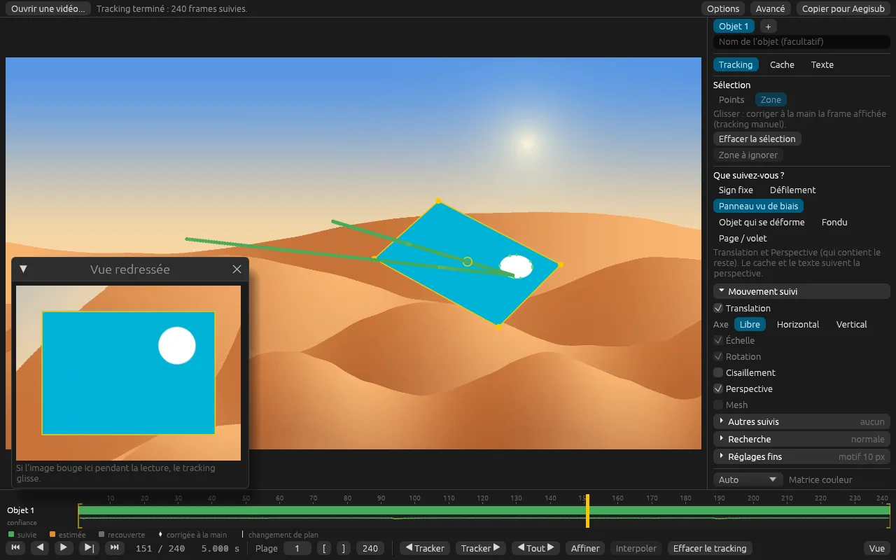

*Le panneau bleu est vu de biais dans la vidéo. En bas à gauche, la vue redressée le montre de face.*

Le menu *Avancé* sert à retoucher ou à remplacer le tracking :

- *Courbes du tracking* montre la position, la taille et la rotation dans le temps. On peut y lisser
  une seule composante (une rotation qui tremble, sans toucher à la position) et retoucher au chiffre
  près la frame affichée. Fenêtre fermée et curseurs à 0, rien ne change.
- *Importer des données de tracking...* lit un fichier « After Effects Keyframe Data » venu de Mocha,
  d'After Effects ou de Blender (position, taille, rotation, ou les 4 coins Power Pin) et l'applique à
  l'objet affiché à partir du début de la plage. Cache, dégradés et texte s'utilisent ensuite comme
  après un tracking normal.

## Autres réglages

### Plusieurs objets

La rangée *Objet 1, Objet 2, +* se trouve en haut des réglages, avec un champ pour nommer l'objet
affiché. Le nom apparaît sur sa piste et dans le récapitulatif d'export. Chaque objet a son tracking,
son cache et son texte. Les autres restent visibles en contour gris, et tous sont exportés ensemble.

### Réglages et session

Les réglages sont enregistrés à la fermeture et à l'export, puis retrouvés quand on rouvre le même
script Aegisub, ou la même vidéo hors Aegisub. Le travail (objets, zones, caches, tracking) est
enregistré aussi : en rouvrant la même vidéo sur la même plage, AegiSignTrack propose de le reprendre
ou de repartir de zéro. L'image d'un cache n'est pas conservée, et une session de plus de 30 jours est
effacée.

### Langue

*Options > Langue / Language*, français ou anglais. Au premier lancement, la langue du système décide.
Le plugin suit ce choix au démarrage suivant d'Aegisub.

### Mises à jour

Au lancement, AegiSignTrack regarde si une release plus récente existe sur GitHub. Il affiche alors la
version installée et la nouvelle, avec un bouton vers la page de téléchargement. Rien ne s'installe
tout seul. Il faut `curl`, fourni avec Windows 10 et 11. La vérification se désactive dans le menu
*Options*.

### Couleurs

Si l'image ou la pipette ne donnent pas les bonnes couleurs, *Matrice couleur*, en haut des réglages,
force BT.709 ou BT.601.

### Résultat différent d'une machine à l'autre

Comparer d'abord la version affichée dans le titre de la fenêtre. Si elle est la même, refaire le
tracking avec les mêmes gestes sur les deux machines, enregistrer *Options > Diagnostic...* et comparer
les deux fichiers : version de ffmpeg, empreintes des images décodées, réglages, sélection, puis
résultat frame par frame.

## Exemples

Ces animations viennent de deux séries de vidéos de test. La zone suivie est tracée en jaune. Elle passe
à l'orange quand la position est estimée, parce que l'objet est caché ou hors champ.

<table>
<tr>
<td align="center" valign="top" width="25%">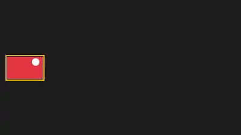<br><sub>Translation</sub></td>
<td align="center" valign="top" width="25%">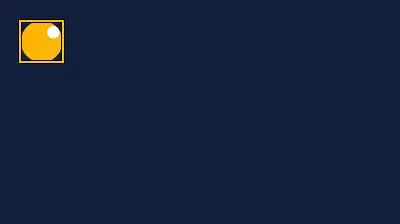<br><sub>Trajectoire courbe, accélérations</sub></td>
<td align="center" valign="top" width="25%">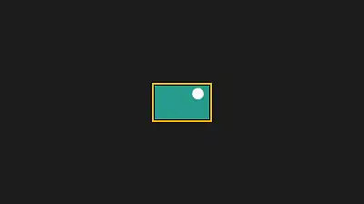<br><sub>Échelle</sub></td>
<td align="center" valign="top" width="25%">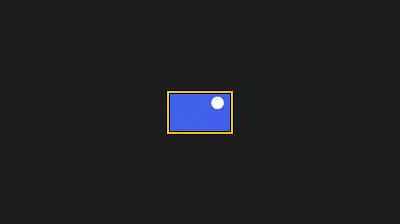<br><sub>Rotation</sub></td>
</tr>
<tr>
<td align="center" valign="top" width="25%">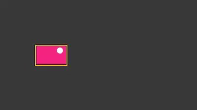<br><sub>Fondu</sub></td>
<td align="center" valign="top" width="25%">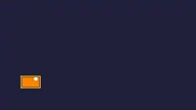<br><sub>Translation, échelle, rotation et fondu</sub></td>
<td align="center" valign="top" width="25%">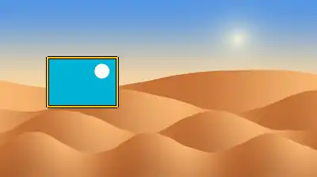<br><sub>Perspective sur fond vidéo</sub></td>
<td align="center" valign="top" width="25%">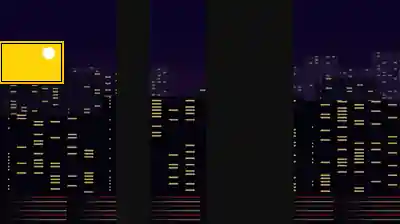<br><sub>Occultation et sortie de cadre</sub></td>
</tr>
<tr>
<td align="center" valign="top" width="25%">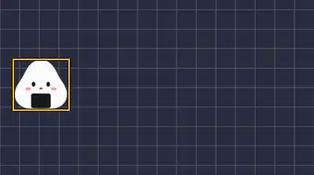<br><sub>Translation</sub></td>
<td align="center" valign="top" width="25%">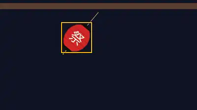<br><sub>Balancier</sub></td>
<td align="center" valign="top" width="25%">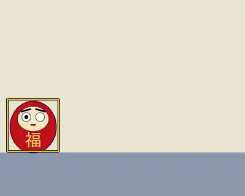<br><sub>Objet qui s'écrase, avec Cisaillement</sub></td>
<td align="center" valign="top" width="25%">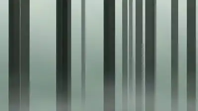<br><sub>Objet qui entre et sort, suivi à rebours</sub></td>
</tr>
<tr>
<td align="center" valign="top" width="25%">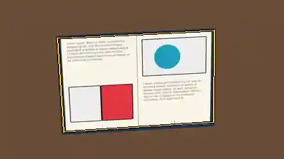<br><sub>Livre en perspective</sub></td>
<td align="center" valign="top" width="25%">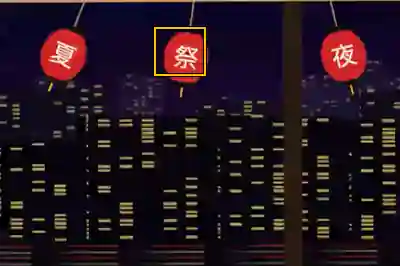<br><sub>Lanterne, caméra à l'épaule</sub></td>
</tr>
</table>

Sept cas des mêmes séries ne figurent pas ici. Dans cinq d'entre eux le suivi décroche encore par
moments : des leurres identiques à la cible, une vidéo qui cumule toutes les difficultés, un éventail
articulé qui se referme, deux objets filmés caméra à l'épaule et un magazine plié en main. Les deux
autres, une bulle qui gonfle et un objet trop gros qui rétrécit, sont suivis mais demandent des
retouches à la main.

## Tests

```sh
cargo test --release
```

Les tests couvrent le tracking, l'export ASS et l'extraction vidéo. Ils ont besoin de ffmpeg.

## Licence

CC BY-NC-SA 4.0, copyright 2026 AnnoyedDev. L'usage commercial est interdit, et toute version modifiée
qui est diffusée doit l'être sous la même licence. Le texte complet est dans `LICENSE`.
